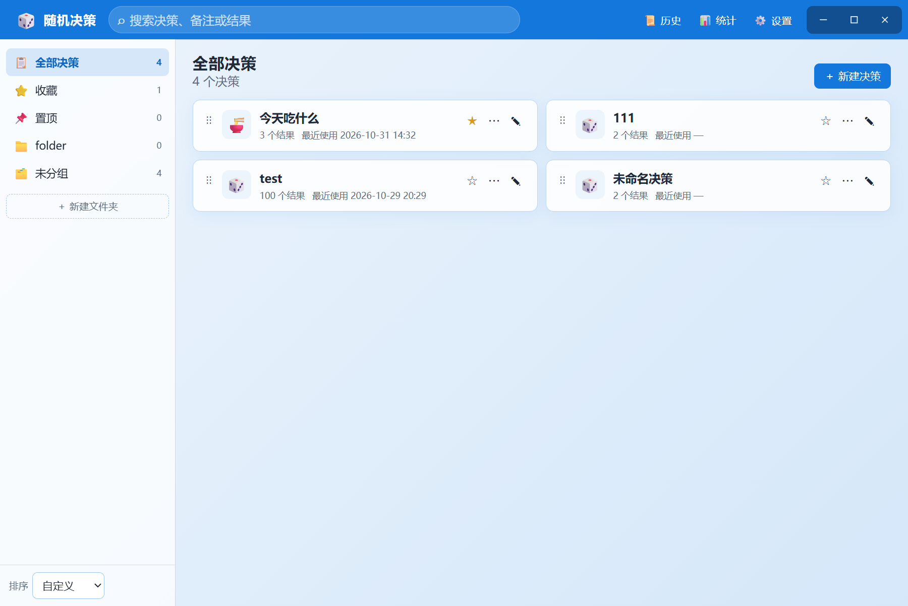
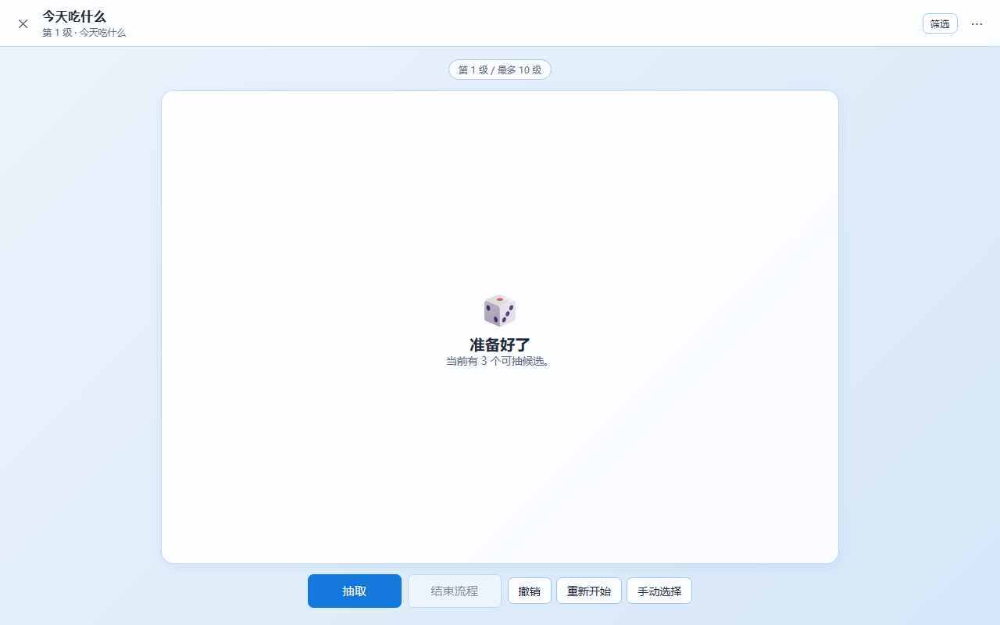
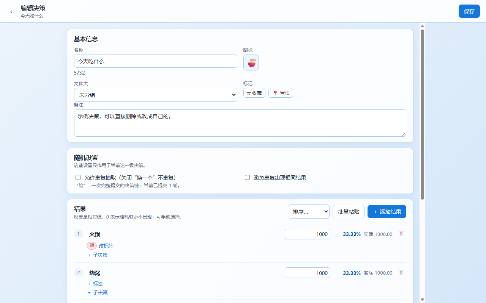
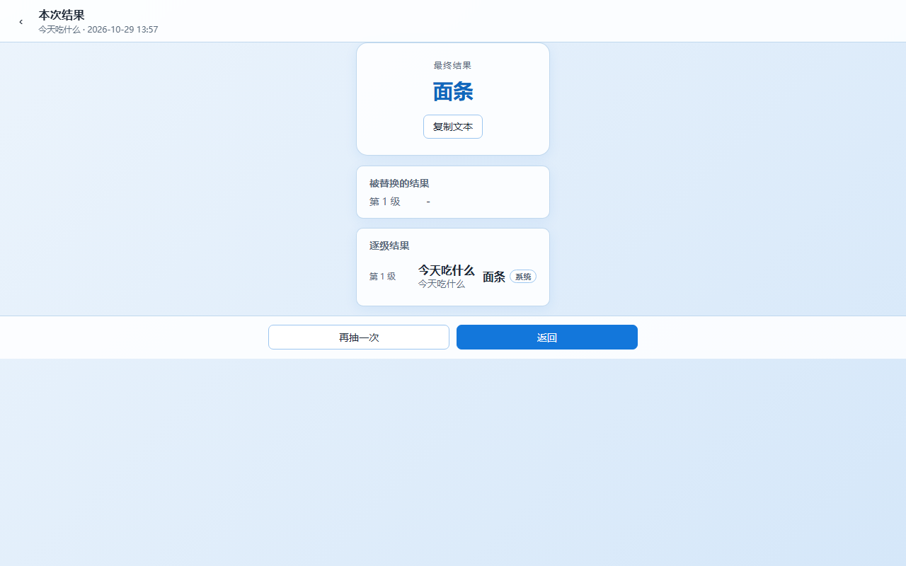

# 随机决策工具

当前版本：**1.0.0**

离线、单机的随机决策辅助工具。两个独立产物，共用同一套核心逻辑与界面：

- **Windows**：便携 exe / 快速解压版，数据放在程序同目录。
- **Android**：可安装 PWA（添加到主屏幕），数据存 IndexedDB。



## 已实现的功能

- 决策/结果/权重（0–1,000,000 整数，0 = 随机时永不出现）、实时概率。
- “换一个”不重复；全部抽过自动重置；允许重复抽取。
  不重复模式下每个正权重结果每轮必定各出现一次，权重只影响出现顺序；要按权重频率抽取，请开启“允许重复抽取”。
- 标签、分组、全局标签预设（独立管理页，可编辑/删除预设、分组和标签）；按分组“不筛选/只看/排除”；组内 OR、跨组 AND。
- 避免重复：按轮降温，可调降低幅度与持续轮数；实际权重 = 基础权重 × (1-r)^k。
- 多级决策树（最多 10 级）、自有子决策、共享引用、复制为独立副本，可从子决策编辑器打开被引用决策。
- 手动选择、临时拉黑、撤销、重新开始、重置状态、退出确认。
- 主界面决策卡片和编辑页结果都支持排序；桌面拖拽，手机端使用上移/下移按钮。
- 汇总页：最终链、手动选择部分、按级被替换结果、复制文本。
- 历史（500 条链，链内明细）、统计（出现/采用/手动分开，不受历史清理影响）。
- 主题色、浅色/深色/跟随系统、背景图（自适应/不透明度/模糊）、字号 5 档；九宫格锚点会等比放大到覆盖整个窗口，并对齐到指定角/边。
- 手机端适配：Android 返回键按“上一级”页面返回、文件夹重命名/删除、文件选择/导入、自定义取色器（指针不越界）。
- 编辑页标签分组颜色可直接点击色点修改；Windows 顶部栏整条可拖动窗口，按钮区域不受影响。
- 全量备份 JSON、历史 JSON 的导出/导入；跨 Windows / PWA；合并导入冲突可逐项选择跳过/覆盖/重命名。
- PWA manifest、图标、service worker 离线缓存。
- Electron 文件存储：`data/app-data.json` + `data/background.*`；无边框窗口与自绘最小化/最大化/关闭按钮。





## 快速开始

### Windows

**推荐使用快速版**：

```
release\随机决策工具-1.0.0-快速版.zip
```

1. 解压到纯英文目录（文件夹和文件名都不要含中文）。
2. 运行 `RandomDecider.exe`。
3. 数据保存在同目录 `data\`；移动时把程序和 `data\` 一起带走。

快速版解压一次即可，启动约 1–2 秒。

**单文件便携版**：

```
release\随机决策工具-1.0.0-portable.exe
```

也可以使用，但每次启动都要把 Electron 解压到临时目录，约 5–8 秒。

请从纯英文路径运行：本机 Electron 45 在中文完整路径下会崩溃（已实测）。`release\` 里的中文名构建产物不能直接双击运行，它只是构建输出；快速版同样要解压到纯英文路径。

- 首次运行会在程序同目录创建 `data\`；如果目录不可写，会回退到 `%APPDATA%\RandomDecider\data`。
- 两个 Windows 版本数据格式相同，切换版本时把 `data\` 一起带走。

从源码运行：

```bash
pnpm install
pnpm build
pnpm electron
```

从源码打包：

```bash
pnpm electron:build
```

> 注意：`pnpm electron` 也请从纯英文路径运行；这是当前 Electron/环境的限制，不是应用逻辑问题。

### Android / 手机 PWA

1. 构建：`pnpm build`，产物在 `dist/`；仓库也提供 `release\随机决策-PWA-1.0.0.zip`。
2. 把 `dist/`（或 zip 解压后的内容）部署到任意 **HTTPS** 静态站点（或在本机 `localhost` 访问）。
3. 手机浏览器打开地址 → 菜单 → “添加到主屏幕”。
4. 首次加载后完全离线可用。

> PWA 的 service worker 和“安装”要求安全上下文（HTTPS 或 localhost）。局域网 `http://192.168.x.x` 也能打开页面，但通常无法注册 service worker、无法真正离线/安装。不提供 APK；如必须 APK，需要 Android SDK 并用 Capacitor 套壳。

> **Netlify 部署注意**：请先解压 zip，把 `index.html` 所在的整个目录作为 publish directory 上传；不要把 zip 文件本身当作站点内容。最新 zip 使用 POSIX 路径（`assets/...`），避免 Linux 解压后变成字面文件名 `assets\index.js` 导致白屏。部署后如仍是旧页面，清除该站点的数据/service worker，或在无痕窗口打开。zip 内已包含 `_headers`，让 `index.html`/`sw.js` 不被长期缓存。

## 数据与备份

- Windows：`data\app-data.json`，背景图 `data\background.png|jpg`；保存时保留一份 `data\app-data.bak.json` 作为本地回滚副本。
- PWA：IndexedDB；背景图以 Blob 存本地。
- 设置页可导出/导入：
  - **全量备份**：决策树、标签预设、统计、历史、设置（不含背景图）。
  - **历史**：500 条链的 JSON，可跨端导入合并。
- 不做自动备份、云同步、账号。
- 背景图不随备份导出；换机后需要重新选择。

## 开发

```bash
pnpm install
pnpm dev          # 浏览器开发（IndexedDB）
pnpm build        # 类型检查 + 构建 dist
pnpm test         # 核心算法测试（19 项）
pnpm electron     # Electron 开发运行
pnpm electron:build
```

技术栈：React 19 + TypeScript + Vite；Electron 45；PWA（manifest + service worker）。核心逻辑在 `src/core`，不依赖 DOM；Windows 文件读写通过 `electron/preload.cjs` 暴露的 `window.desktop`，浏览器/PWA 使用 IndexedDB。

目录：

```
src/core/     数据模型、随机、权重、降温、标签、历史、统计、JSON
src/ui/       React 页面、组件、主题、存储适配
electron/     Electron 主进程与 preload
public/       manifest、service worker、图标
test/         核心算法测试（Node 直接运行）
需求规格-v1.md 完整需求规格
```

## 已知限制

- 全量备份导入支持“合并”和“覆盖”；合并遇到同名顶级决策会逐项选择跳过/覆盖/重命名，文件夹/预设仍按名称去重。历史导入按记录 ID 合并去重。
- 删除被引用的决策时可选“解除引用后删除”或“级联删除所有引用”。
- 从子决策编辑器“打开”被引用决策时会先保存当前编辑；有进行中的抽取会话时不显示该按钮。
- 没有背景音乐、加锁/隐藏、多设备同步、自动备份。
- 统计/历史在删除决策后保留，孤立记录会标“已删除”。
- PWA 安装在 iOS 上可能被系统清理站点数据；请定期导出备份。
- **Electron 在中文路径下会崩溃**：请把 exe/快速版与 `data\` 一起放到纯英文目录；不要直接双击 `release\` 下的中文名产物。

## 验证记录

- 核心测试：19/19 通过（权重边界、降温 3 轮示例、不重复/自动重置、手动选择、标签筛选、多级/引用/撤销/重开、历史 JSON、提交幂等、0 权重、单候选、引用查找、合并导入、导入冲突覆盖/重命名、预设部分标签应用、系统随机数范围与加权分布）。
- 移动端：无头 Edge 移动视口验证文件夹重命名/删除、自定义取色器指针、深色/跟随系统、Android 返回按上一级页面（决策列表→分组）、手机端上移/下移排序；文件选择事件（选择图片/导入历史/合并导入）均能打开。
- 桌面端：整条顶部栏拖动后，实测最小化/最大化/还原/关闭仍可点击；快速版在纯英文目录启动正常。
- PWA：manifest、service worker 激活、断网重载通过；Netlify 用解压目录验证资源全部 200。

## 需求文档

- [`需求规格-v1.md`](需求规格-v1.md)：实现依据。
- [`CHANGELOG.md`](CHANGELOG.md)：版本变更。
- [`发布说明-1.0.md`](发布说明-1.0.md)：1.0 发行包与校验值。

## 许可证

本项目采用 MIT 许可证，Copyright (c) 2026 Random Decider。
